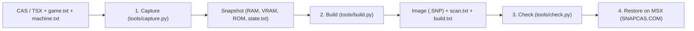

# Design Overview

This document explains how `snapcas` works at a high level, why it is built the way it is, and what its architectural limits are. For byte-level formats, see [FORMATS.md](FORMATS.md); for implementation details, see [docs/internals/](internals/capture.md).

## Overview

`snapcas` converts MSX cassette games into self-contained `.SNP` snapshot images that load from disk or SD card on a real MSX1, MSX2, or MSX2+. Instead of emulating a tape player on the MSX while fragile 1980s loaders run against modern slot layouts, `snapcas` runs each loader once in `openMSX` configured like the user's hardware, captures the complete machine state, and restores it directly on hardware with `SNAPCAS.COM`.

### Key terms

| Term | Meaning |
|---|---|
| **Page** | One of the four 16 KB Z80 address windows (`0000h`–`3FFFh`, `4000h`–`7FFFh`, `8000h`–`BFFFh`, `C000h`–`FFFFh`). |
| **Slot / subslot** | Hardware source for a page: primary slot `0–3` and, in an expanded slot, subslot `0–3`. |
| **Slot ID** | Single-byte slot encoding: bit 7 = expanded, bits 3–2 = subslot, bits 1–0 = primary slot. |
| **Segment** | A 16 KB memory mapper bank selected via ports `FCh`–`FFh`. |
| **DOS's mapper** | The memory mapper holding DOS's four pages when `SNAPCAS.COM` starts. |
| **Worker** | The portion of `SNAPCAS.COM` running in page 1 or 2 while it restores the other pages. |
| **Tail** | 26 bytes of restore code written below the game's stack pointer that switches into the game's final slot/mapper state and jumps to `PC`. |
| **T0** | A RAM copy of BIOS page 0 whose tape entries (`00E1h`–`00F3h`) redirect into the tape service. |
| **Code segment** | Mapper segment holding the tape service's routines and the start of the remaining tape data. |

## Pipeline

Every `.SNP` image passes through four stages, orchestrated by `tools/pipeline.py` (invoked by `./snapcas.py snap` and `make games`):

1. **Tape reading:** Separate readers (`tools/cas.py`, `tools/tsx.py`) parse `.CAS` and `.TSX` files into a single format-neutral block model used by all later stages.
2. **Capture ([capture.md](internals/capture.md)):** `tools/capture.py` boots a headless `openMSX` matching the target machine (or a capture variant), clears DOS hooks/work area so the machine looks like a cassette MSX, loads the tape, applies automatic slot/loader patches ([patches.md](internals/patches.md)), and snapshots RAM, VRAM, ROMs, and registers at an interrupt entry.
3. **Build ([service-and-resident.md](internals/service-and-resident.md)):** `tools/build.py` packs RAM pages, VRAM blocks, VDP/PSG/PPI port writes, and the 26-byte tail into a `.SNP` image. Multi-load games also receive `T0`, the tape service (either with a page 3 stub or in `T0`-only mode), and a scan that patches direct tape calls. Machines with a `resident` program (such as SX2RES) also get an interrupt call hook.
4. **Check & Restore ([restorer-and-check.md](internals/restorer-and-check.md)):** `tools/check.py` boots DOS in `openMSX`, runs `SNAPCAS.COM`, and verifies 4 points over 60 seconds (state match, no writes to service/resident areas, no crash/reboot, no BASIC error). When a step fails and no `capture` variant is pinned, `pipeline.py` retries the machine's `variant` list automatically.

## Design decisions

| Decision | Why |
|---|---|
| **Snapshot instead of live CAS playback** | Loaders run once in `openMSX`; their slot probing, copy loops, and timing checks never have to survive modern hardware. |
| **Snapshot at an interrupt entry** | CPU state is self-contained, interrupts are off (`IFF1 = 0`), and the 26 bytes below `SP` are guaranteed free for the tail. |
| **Precompute port writes, T0, and tail on the host** | Keeps `SNAPCAS.COM` small and fast; the restorer only allocates segments, loads records, and fills machine-dependent slot/segment bytes. |
| **ROM CRC-16 verification at restore time** | Snapshots rely on exact BIOS entry points and `T0` is built directly from `rom.bin`, so mismatched ROMs must be rejected immediately. |
| **One universal `SNAPCAS.COM`** | Users maintain a single restorer binary that accepts any `.SNP` image matching its `IMAGE_FORMAT`. |
| **Capture variants (`machines/capture/`)** | Some loaders trip over a disk cartridge or expanded slot 0 that the running game never touches again; capturing without it lets the image run cleanly on the full machine. |
| **Watch-based slot patching during capture** | Watching live `OUT (0A8h),A` / `WSLREG` writes patches only executed code, avoiding false positives in data or checksummed blocks. |
| **Tape service only for multi-load games** | Single-load games run with zero resident overhead and keep their exact captured memory map. |
| **Automatic tape by default, `/M` manual mode optional** | Most players want hands-off loading; `/M` supports games with explicit stop/rewind prompts. `GRAPH` (Side A) and `CODE` (Side B) avoid keys games and BASIC read; `RETURN` waits for key release before resuming. |
| **Reboot/crash detection rather than banning all resets** | Some loaders intentionally reset the MSX to start a RAM-resident ROM image; point 3 checks where the machine ends up (DOS/boot screen, `RST 38h` flood, or wrapped `SP`). |

## Limits

- **Standard blocks only after snapshot:** The virtual tape service only serves BIOS-format blocks. Multi-load `.TSX` games with post-snapshot custom/turbo blocks cannot run unless `service no` applies.
- **Four active mapper segments:** Games that dynamically page more than the 4 mapper segments active at snapshot time are not supported.
- **Single DOS mapper:** DOS's four pages must live in one memory mapper with enough free segments for holding pages, service segments, and the worker. Very long tapes (e.g. `RELICS`, needing 33 free segments) exceed 512 KB mappers.
- **Page 3 or `T0`-mode requirements:** Multi-load games need either 158 bytes free in page 3 (26-byte entries at `xxE1h` + 132-byte code block, contiguous or split, plus 23 bytes for `sub0` when page 0 is in DOS's expanded slot) or compatibility with `T0`-only mode (page 0 RAM outside DOS's mapper, tape ≤ 16 segments / 256 KB, no `rom keep`, automatic tape only, and no `TAPIN` header-skip).
- **Custom tape readers:** Games that read cassette audio directly via PSG port `A2h` without BIOS `TAPION`/`TAPIN` only work if they finish loading before the snapshot.
- **Tail placement:** The 26 bytes below `SP` (or below the page boundary if `SP` is within 26 bytes of one) must lie in a kept RAM page and not include `FFFFh`.
- **Expanded slot 0 & `FFFFh`:** Games whose stack or data writes `FFFFh` in an expanded page-3 slot corrupt the subslot register and need either an unexpanded capture variant or a patch. Unexpanded-slot-0 capture variants assume the main ROM lives in subslot 0 and that the game does not write slot 0's subslot register after restore.
- **Hardware quirks beyond 60 s:** `--check` runs for 60 seconds without playing the game, so real-hardware testing remains the final check (for example, BASIC `PLAY` music running at snapshot time stalls on a real Sanyo PHC-28S).
